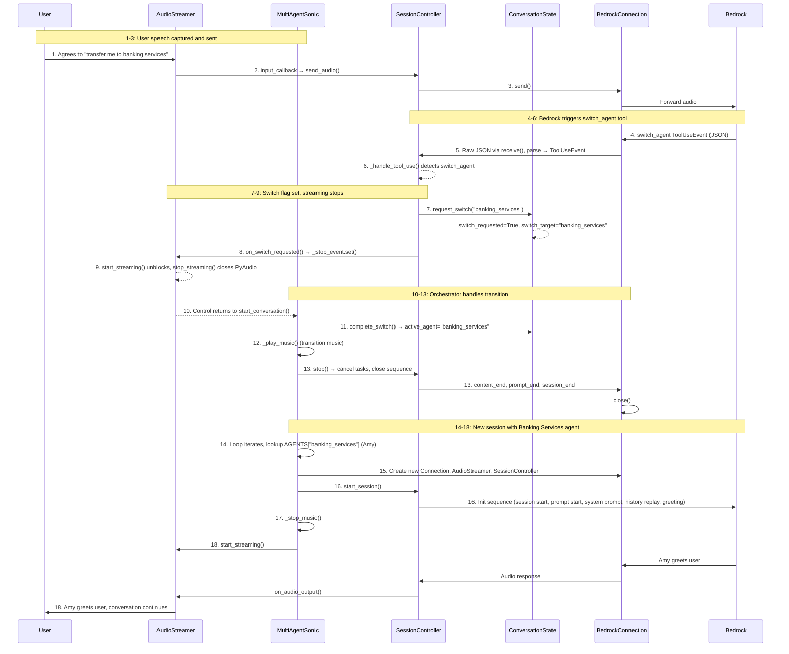

# Nova 2.5 Sonic Dynamic Configuration For Multi-Agent System

A speech-to-speech dynamic configuration approach for multi-agent systems using Amazon Bedrock's Nova 2.5 Sonic model (`amazon.nova-2-5-sonic`).

## The Problem

Speech-to-speech models have static configuration - once a conversation starts, you're locked into a single system prompt, one set of tools, and fixed voice characteristics. When different use cases need different configurations, a single generalist agent can't deliver the precision of specialized agents.

## The Solution

Dynamic configuration using tool triggers - enabling real-time configuration changes mid-conversation without losing context.

- Multiple specialized agents with focused tools and optimized prompts
- Seamless transitions based on user intent
- Preserved conversation history across switches
- Agent specialization for better accuracy

## Agents

| Agent | Voice | Role | Tools |
|-------|-------|------|-------|
| Customer Support (Matthew) | matthew | Customer issues, KB lookup, ticketing, account servicing | `search_knowledge_base`, `create_support_ticket`, `get_account_details` |
| Banking Services (Amy) | amy | Cards, loans, accounts, product info, eligibility | `lookup_customer_crm`, `get_product_info`, `check_eligibility` |
| Transactions (Tiffany) | tiffany | Transaction history, disputes, spending monitoring | `get_transaction_history`, `file_dispute`, `get_spending_summary` |

All agents share the `switch_agent` tool for seamless handoffs. Each agent asks the caller to confirm before transferring.

## Architecture

```
MultiAgentSonic (orchestrator, while-loop)
      │
      ├→ ConversationState (shared across sessions, owns history + switch state)
      ├→ ToolRegistry (shared across sessions, built once from AGENTS)
      │
      └→ per session:
            ├→ BedrockConnection (raw bidirectional stream)
            ├→ AudioStreamer (PyAudio mic/speaker I/O, implements StreamCallback)
            └→ SessionController (lifecycle coordinator)
                    │
                    ├→ ResponseParser (stateless JSON → typed events)
                    ├→ EventTemplates (protocol JSON generation)
                    ├→ ConversationState (history replay, switch requests)
                    ├→ ToolRegistry (schema lookup, tool execution)
                    └→ StreamCallback → AudioStreamer (audio output, barge-in, switch signal)
```

## Project Structure

```
├── main.py                              # Entry point (--debug flag)
├── assets/
│   ├── music.mp3                        # Agent switch transition music
│   └── agent switch example.mp4         # Demo video
├── src/
│   ├── multi_agent.py                   # MultiAgentSonic orchestrator
│   ├── config.py                        # Audio, AWS, model configuration
│   ├── display.py                       # Terminal display (Rich)
│   ├── utils.py                         # Debug logging & timing
│   ├── connection/                      # Bedrock protocol layer
│   │   ├── bedrock_connection.py        # Raw bidirectional stream
│   │   ├── response_parser.py           # Stateless JSON → typed events
│   │   ├── event_templates.py           # Event JSON generators
│   │   └── stream_events.py             # Typed event dataclasses
│   ├── session/                         # Session & state management
│   │   ├── session_controller.py        # Conversation lifecycle coordinator
│   │   ├── conversation_state.py        # State ownership
│   │   └── callbacks.py                 # StreamCallback protocol
│   ├── agents/                          # Agent definitions & tools
│   │   ├── agent_config.py              # Agent + ToolDefinition configs
│   │   ├── tools.py                     # Tool implementations
│   │   └── tool_registry.py             # Unified tool registry
│   └── audio/                           # Audio I/O
│       └── audio_streamer.py            # PyAudio with StreamCallback
```

## Setup

1. Install portaudio (required by PyAudio):
```bash
brew install portaudio
```

2. Install dependencies:
```bash
pip install -r requirements.txt
```

3. Configure AWS credentials:
```bash
export AWS_ACCESS_KEY_ID="your_key"
export AWS_SECRET_ACCESS_KEY="your_secret"
export AWS_REGION="us-east-1"
```

4. Enable Nova 2.5 Sonic model access in the Amazon Bedrock console. Nova 2.5 Sonic is available in `us-east-1`, `us-west-2`, `eu-north-1`, and `ap-northeast-1`. If `amazon.nova-2-5-sonic` isn't directly invokable in your account, set `DEFAULT_MODEL_ID` to the cross-region inference profile `us.amazon.nova-2-5-sonic`.

5. Run:
```bash
# Normal mode
python main.py

# Debug mode (verbose logging)
python main.py --debug
```

## Requirements

- Python 3.12+
- Amazon Bedrock access with Nova 2.5 Sonic enabled
- Microphone and speakers
- portaudio (for PyAudio)

## Agent Switching Flow



## Configuration

Edit `src/config.py`:
- Audio: `INPUT_SAMPLE_RATE`, `OUTPUT_SAMPLE_RATE`, `CHUNK_SIZE`, `CHANNELS`
- AWS: `DEFAULT_MODEL_ID`, `DEFAULT_REGION`
- Model: `MAX_TOKENS`, `TEMPERATURE`, `TOP_P` (`TOP_P` must be above `0`: Nova 2.5 Sonic fails before responding with `TOP_P = 0.0`)

## Prompt Design

Prompts and tools follow the [Nova Sonic 2.5 Prompt Engineering Best Practices Guide](https://github.com/aws-samples/amazon-nova-samples/blob/main/speech-to-speech/amazon-nova-2.5-sonic/Nova_Sonic_2.5_Prompting_Guide.md). Nova 2.5 Sonic follows instructions more literally and answers more concisely than Nova 2 Sonic, so:

- Each system prompt is built by `_build_instruction()` from bracketed sections: `[ROLE]`, `[STYLE]`, `[WORKFLOW]`, `[TOOL RULES]`, `[TRANSFERS]`, `[EXAMPLE]`, `[FINAL CHECK]`. Style, tool, transfer, and final-check rules are shared across agents.
- Instructions are positive and stated once, with one rule per bullet.
- Tool-call turns are silent: the model calls the tool as its entire response, then speaks about the result.
- Tool descriptions say what the tool does and returns; routing and speech policy live in the system prompt.
- Tools that confirm an action (`create_support_ticket`, `file_dispute`) return a `speak` line and a `next` step, so the confirmation number is only available from the tool result.

## Known Limitations

- **8-minute session limit**: Nova 2.5 Sonic closes each session after 8 minutes. Sessions only restart on an agent switch, so a single-agent conversation longer than that will stop responding.

## Adding New Agents

1. Implement tool function in `src/agents/tools.py`
2. Add `Agent` with `ToolDefinition` to `AGENTS` dict in `src/agents/agent_config.py`, building its instruction with `_build_instruction()` (role, workflow, example)
3. Add the new agent and a short description of what it handles to `SWITCH_AGENT_ROLES` in `src/agents/tool_registry.py`

## Credits

Music by [Ievgen Poltavskyi](https://pixabay.com/users/hitslab-47305729/) from [Pixabay](https://pixabay.com/)
